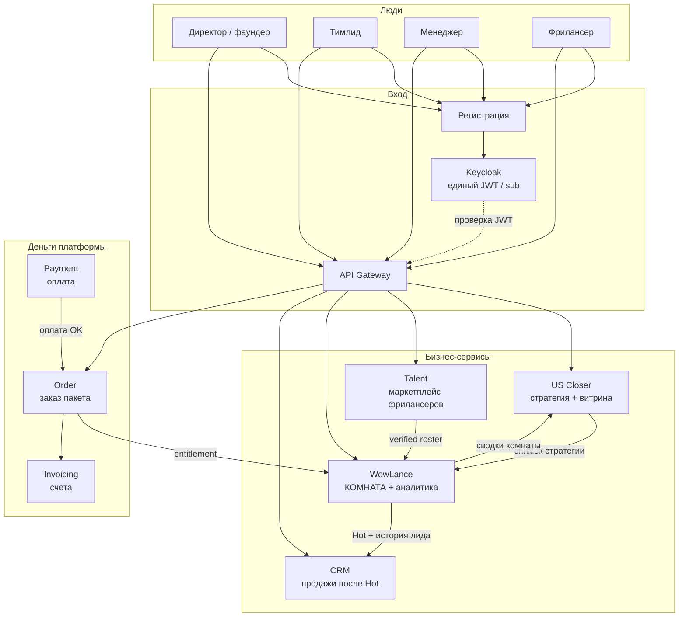
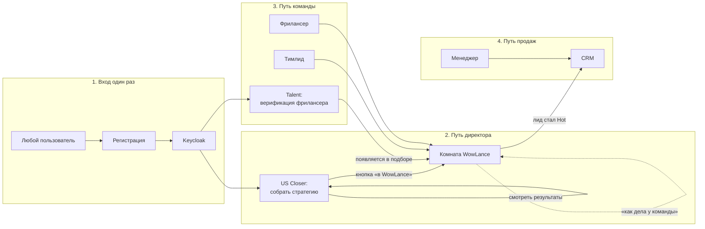
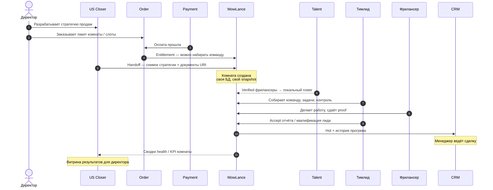
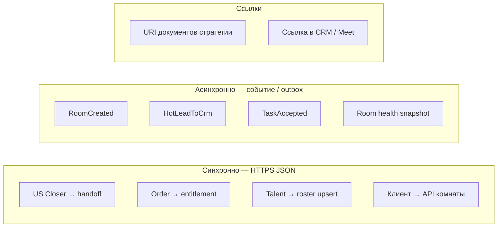

# WOWLANCE — схема движения людей и информации

| Поле | Значение |
|------|----------|
| **Дата** | 2026-10-24 |
| **Для кого** | Стейкхолдеры, тимлиды смежных сервисов |
| **Фокус** | WowLance = микросервис **комнаты** и операционной аналитики |
| **Канон комнаты** | [ADR-002](ADR-002-wowlance-2.0-platform-room.md) · [REGISTRY](../contracts/REGISTRY.md) |
| **Графика** | [обзорная PNG](261024%20-%20схема%20платформы%20WOWLANCE.png) · [техническая PNG](261024%20-%20схема%20платформы%20WOWLANCE%20tech.png) |

---

## 0. Графические схемы

### 0.1. Обзор (люди и сервисы)


[`261024 - схема платформы WOWLANCE.png`](261024%20-%20схема%20платформы%20WOWLANCE.png) · `python scripts/render_platform_diagram.py`

### 0.2. Техническая (БД, снимки, кто куда читает)


[`261024 - схема платформы WOWLANCE tech.png`](261024%20-%20схема%20платформы%20WOWLANCE%20tech.png) · `python scripts/render_platform_diagram_tech.py`

На технической схеме явно:

| Поток | Смысл |
|-------|--------|
| ① US Closer → WL | **Копия** снимка стратегии в БД комнаты (не live-чтение БД US Closer) |
| ② Talent → WL | **Снимок** verified в локальный roster; matching только по своей БД |
| ③ WL → CRM | Hot + история **событием/API**, не JOIN в БД комнаты |
| ④ WL → US Closer | Фаундер читает аналитику **в US Closer**; туда приходят агрегаты RoomHealth |
| ⑤ WL → Talent | Сигналы TaskAccepted / MemberTerminated |
| ⑥ Order/Payment → WL | Entitlement → флаг `staffing_unlocked` в БД WL |

**Правило:** чужие таблицы не читаем. У каждого сервиса — своя PostgreSQL.

---

## 1. Одним взглядом: кто за что отвечает

| Сервис | За что отвечает | Чего **не** делает |
|--------|-----------------|---------------------|
| **Регистрация + Keycloak** | Единый вход: директор, тимлид, менеджер, фрилансер, админ. Один `sub` (ID пользователя) на всю платформу | Не хранит комнаты, сделки, стратегию |
| **US Closer** (стратегия) | Разработка стратегии продаж, SOP, кабинет результатов фаундера | Не управляет ежедневными задачами команды |
| **Talent** | Маркетплейс **верифицированных** фрилансеров, готовых к работе | Не ведёт комнату и Hot-лиды |
| **WowLance** | **Комната**: команда, задачи, прогрев лидов, отчёты, сводки «как дела у команды» | Не редактор стратегии; не полноценная CRM; не регистрация |
| **CRM** (внешняя) | Ведение продаж **после** прогрева (Hot) | Не заменяет комнату SDR |
| **Order** | Заказ пакета комнаты / слотов | Не счёт конечному клиенту-лиду |
| **Payment** | Оплата заказа (деньги прошли) | Не entitlement-логика комнаты сама по себе |
| **Invoicing** | Счета / закрывающие по заказам платформы | Не воронка сделки в CRM |

**Главная идея:** люди входят через Keycloak; стратегия рождается в US Closer; люди для работы приходят из Talent; исполнение и прогрев — в WowLance; закрытие сделки — в CRM; деньги за пакет комнаты — Order → Payment → Invoicing.

---

## 2. Карта платформы (сервисы)



---

## 3. Движение **людей** (куда какой роли ходить)



| Роль | Основной сервис | Зачем заходит в WowLance |
|------|-----------------|---------------------------|
| Директор | US Closer | Иногда: детали команды, задачи, операционка |
| Тимлид | WowLance | Состав, задачи, приёмка, квалификация лидов |
| Фрилансер | WowLance (+ профиль в Talent) | Задачи, отчёты, «я заработал» |
| Менеджер | CRM | В комнате почти не живёт; забирает Hot |
| Админ | Keycloak / админ-контуры | Не продукт комнаты |

---

## 4. Движение **информации** (сквозной сценарий)

От идеи до денег — **один сюжет**, разные владельцы данных.



### Что именно передаётся (просто)

| Откуда → куда | Что едет | Зачем |
|---------------|----------|--------|
| US Closer → WowLance | Снимок стратегии (версия, оффер, ICP, hot-критерии, URI файлов) | Комната работает по **зафиксированной** версии |
| Order/Payment → WowLance | «Пакет оплачен» (entitlement) | Без этого нельзя staff’ить команду |
| Talent → WowLance | Карточка verified-фрилансера (skills, level, sub) | Подбор и назначение в комнате |
| WowLance → CRM | Hot-лид + **история** из упрощённой внутренней воронки | Менеджер не начинает с нуля |
| WowLance → US Closer | Агрегаты «здоровья» комнаты (слоты, задачи, лиды, earned) | Директор видит результат в одном кабинете |
| WowLance → Talent | Сигналы: задача принята, участник расторгнут | Рейтинг / доступность на маркетплейсе |
| Keycloak → все | JWT с `sub` | Один человек = один ID везде |

---

## 5. Упрощённая внутренняя воронка vs внешняя CRM

```text
Внутри WowLance (SDR / прогрев)     Внешняя CRM (AE / закрытие)
─────────────────────────────       ────────────────────────────
  open → hot  ──────── handoff ──►  сделка, стадии, won/lost
  история касаний, заметки  ─────►  передаётся вместе с лидом
  НЕ полноценная воронка менеджера  менеджер работает ЗДЕСЬ
```

**Решение для стейкхолдеров:** в комнате — короткий контур прогрева; «настоящие» продажи после Hot — в отдельном CRM. История не теряется: уходит в handoff.

---

## 6. Основные технические решения (коротко)

| # | Решение | Зачем бизнесу |
|---|---------|----------------|
| 1 | **У каждого сервиса своя БД** | Нет «общей каши»; сервисы можно менять независимо |
| 2 | **Связь по контрактам** (API / события), не по чужим таблицам | Соседи договариваются о полях один раз (OpenSpec) |
| 3 | **Один вход — Keycloak** | Директор и фрилансер не плодят разные логины |
| 4 | **Снимок стратегии в комнате** (Hybrid) | Команда не зависит от правок в US Closer mid-flight; новая версия — Accept тимлида |
| 5 | **Файлы в object storage**, в событиях только URI + версия + checksum | Тяжёлые SOP не гоняем через брокер |
| 6 | **Staffing только после entitlement** | Комната может создаться раньше, набор людей — после оплаты пакета |
| 7 | **Outbox событий** из комнаты | Надёжная доставка «комната создана / Hot / задача принята» даже если сосед временно лежит |
| 8 | **Gateway + JWT** снаружи; service-token между сервисами | Люди идут через Gateway; сервис↔сервис — отдельно |



---

## 7. Что входит в WowLance, а что — нет

```text
           ┌─────────────────────────────────────────┐
           │              WowLance                   │
           │  комната · команда · задачи · прогрев   │
           │  упрощённая история лида · сводки       │
           └─────────────────────────────────────────┘
                         ▲
     US Closer           │           Talent
   (стратегия) ──────────┤────────── (люди)
                         │
     Order/Payment       │           CRM
   (пакет комнаты) ──────┤────────── (сделка после Hot)
                         │
                   Keycloak / Регистрация
                      (кто ты такой)
```

| В WowLance | Не в WowLance |
|------------|----------------|
| Комната, слоты, задачи, QG | Редактор стратегии (US Closer) |
| Прогрев лида до Hot | Полноценная CRM менеджера |
| Локальный roster на время проекта | Онбординг/верификация (Talent) |
| Сводки для US Closer | Регистрация и пароли (Keycloak) |
| Handoff истории в CRM | Счета клиенту-лиду (CRM / Invoicing иное) |

---

## 8. Фраза для презентации

> **Регистрация** даёт личность, **US Closer** — план продаж, **Talent** — проверенных людей, **Order/Payment** — право собрать команду, **WowLance** — комнату исполнения и прогрева, **CRM** — закрытие сделки.  
> Информация ходит **контрактами**, люди — **одним логином Keycloak**, у каждого сервиса — **своя база**.

---

## Связанные документы

- [ADR-002 — границы комнаты](ADR-002-wowlance-2.0-platform-room.md)  
- [Реестр контрактов](../contracts/REGISTRY.md)  
- [Владельцы контрактов](contracts-owners.md)  
- [Зоны разработки до согласования](261022%20-%20зоны%20разработки%20до%20согласования%20контрактов.md)  
- Техническая карта (раньше Strategy/SRM): [05-integration-map](architecture/05-integration-map.md)
