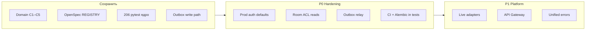

# Технический аудит кода и обоснование рефакторинга — WowLance 2.0

| Поле | Значение |
|------|----------|
| **Дата** | 2026-10-26 |
| **Репозиторий** | `WowLance-2.0` (`main`) |
| **Канон** | [ADR-002](ADR-002-wowlance-2.0-platform-room.md) |
| **Ориентир QA** | [C38 / C0–C37](261025%20-%20QA%20полный%20прогон%20C0-C37%20отчёт.md) — **206 passed** |
| **Предыдущая оценка** | [261021 — оценка готовности](261021%20-%20оценка%20готовности%20и%20качества.md) (срез C0–C25) |
| **Цель документа** | Обосновать **полный rewrite** vs **точечные улучшения** на этапе разработки; дать приоритизированный backlog с опорой на строки кода |

---

## 0. Executive summary (для тимлида / стейкхолдеров)

| Вопрос | Ответ |
|--------|--------|
| **Нужен ли полный рефакторинг / rewrite приложения сейчас?** | **Нет.** Ядро C1–C5 и последующие вертикальные срезы (до C37) согласованы с ADR-002, OpenSpec и ~206 интеграционными тестами. Стоимость rewrite >> выигрыш. |
| **Что это по зрелости?** | Зрелый **stub-микросервис комнаты**: demo/MVP ~9/10, live-платформа ~5/10, качество кода ~7.5/10. |
| **Главный технический долг** | Не «плохой домен», а **platform hardening**: дефолты auth/internal открыты, outbox без relay, read-API без ACL, нет CI, pytest ≠ Alembic. |
| **Рекомендуемая стратегия** | **Инкрементальный рефакторинг** слоями (P0 → P1 → P2), без сноса handoff / entitlement / snapshot / slots. |

**Формулировка для обоснования инвестиций:**  
приложение **не требует переписывания**, но **нельзя масштабировать / выставлять наружу** без закрытия P0. Дальнейшая разработка должна идти **точечными улучшениями** (auth defaults, ACL, outbox relay, adapters, CI), иначе долг накопится именно в интеграционном контуре, а не в бизнес-логике комнаты.

---

## 1. Объект аудита и масштаб кода

Снимок на 2026-10-26 (`main`, ~169 коммитов):

| Контур | Объём (оценка) | Комментарий |
|--------|----------------|-------------|
| Backend `app/` + `tests/` + contracts + frontend `src/` | **~23.5k LOC** (py/ts/tsx/yaml) | Без `node_modules` / venv |
| Крупнейшие модули | `domain/schemas.py` ~601 · `SlotsPanel.tsx` ~543 · `db/models.py` ~471 · `TasksPanel.tsx` ~465 · `domain/staffing.py` ~408 | Домен и UI панелей — основная масса |
| Фазы продукта | **C0–C37** (+ QA C38) | Vertical slices + UX polish C29–C36 |
| Автотесты | **206** `def test_*` | Real PostgreSQL `wowlance_test` |
| Миграции Alembic | **18** файлов | Head: `014_c27_room_members` |
| CI (`.github`) | **Отсутствует** | Риск регрессий при merge без локального pytest |

Архитектурный каркас (сохранять):

```
contracts/*.yaml  →  domain/schemas.py (Pydantic)
                  →  domain/* (инварианты)
                  →  api/* (тонкие роутеры)
                  →  frontend panels + types.ts
```

---

## 2. Вердикт: полный rewrite vs точечный рефакторинг

### 2.1. Почему полный rewrite **не** оправдан

1. **Доменная модель C1–C5 соответствует ADR-002**  
   FounderHandoff → immutable snapshot → entitlement unlock → room read → slots/strategy proposal — это не «временный хак», а канон Hybrid C (start A). Переписывание уничтожит выровненные контракты и 206 тестов без новой архитектурной идеи.

2. **Инварианты закреплены в БД, а не только в Python**  
   Partial unique indexes «один active snapshot / один pending proposal»:

```94:105:backend/app/db/models.py
class StrategySnapshot(Base):
    """Immutable strategy snapshot. History: one active, rest superseded."""

    __tablename__ = "strategy_snapshots"
    __table_args__ = (
        Index(
            "uq_strategy_snapshots_one_active",
            "room_id",
            unique=True,
            postgresql_where=text("status = 'active'"),
        ),
    )
```

```132:143:backend/app/db/models.py
class StrategyProposal(Base):
    """Inbox of a published strategy version awaiting Accept/Reject."""

    __tablename__ = "strategy_proposals"
    __table_args__ = (
        Index(
            "uq_strategy_proposals_one_pending",
            "room_id",
            unique=True,
            postgresql_where=text("status = 'pending'"),
        ),
    )
```

3. **Идемпотентность handoff — осознанное сильное решение**  
   Fingerprint + replay без мутации `staffing_unlocked` / snapshot:

```65:83:backend/app/domain/handoff.py
def process_founder_handoff(db: Session, body: FounderHandoffRequest) -> HandoffResult:
    fp = fingerprint_payload(body)
    existing = db.scalar(select(Room).where(Room.handoff_id == body.handoff_id))
    if existing is not None:
        if existing.request_fingerprint != fp:
            raise HandoffConflictError(
                "handoff_id already bound to a different payload"
            )
        # Immutable: do not touch StrategySnapshot or staffing_unlocked on replay.
        upsert_membership(db, existing.id, existing.founder_sub, ROLE_FOUNDER)
        db.commit()
        return HandoffResult(
            ...
            http_status=200,
        )
```

4. **Слойность приемлема для размера сервиса**  
   Роутеры тонкие; инварианты staffing / QG / lead FSM / RBAC живут в `domain/`. Нет «God `main.py`» и нет anemic CRUD-everywhere. Over-engineering (CQRS, event sourcing, multi-bounded monolith) сейчас **ухудшил бы** скорость стажировочной поставки.

5. **Регрессионный щит уже есть**  
   QA C38: `206 passed` на реальной PostgreSQL. Rewrite с нуля отбрасывает этот щит на месяцы.

### 2.2. Когда rewrite *стоило бы* пересмотреть (триггеры ADR, не «плохого кода»)

| Триггер | Почему |
|---------|--------|
| Strategy/Talent навязывают модель **без snapshot** (live-only B) | Ломает C1/C5 канон — нужен новый ADR, не «рефактор файлов» |
| Решение **влить комнату обратно в Django-монолит 1.0** | Смена границы сервиса |
| Отказ от transactional outbox в пользу только sync HTTP без журнала | Другая integration story |
| Команда платформы требует **единый Gateway + codegen** с жёстким OpenAPI-first | Большой P1, но всё ещё не обязательно полный rewrite домена |

### 2.3. Что **нужно** рефакторить точечно (обоснование инвестиций)

Долг носит характер **production readiness**, а не «кривой бизнес-логики»:

| Категория | Симптом | Почему нельзя игнорировать при scale |
|-----------|---------|--------------------------------------|
| Security defaults | Auth / internal / RBAC **выключены** по умолчанию | Любой с URL/UUID = полный доступ в misconfigured deploy |
| Delivery | Outbox пишется сразу `status="sent"` | Нет at-least-once к соседям; «журнал» ≠ доставка |
| Authorization | GET room/tasks/leads без membership | IDOR по UUID комнаты |
| Ops | Нет CI; pytest через `create_all`, не Alembic | Drift миграций и тихие регрессии |
| Maintainability | 11 копий `RoomNotFoundError`; дубль `_map_errors` | Рост стоимости каждой новой фазы C* |

---

## 3. Архитектурные решения: good / bad / risky

### 3.1. Good — сохранять и наращивать

| Решение | Доказательство | Почему важно |
|---------|----------------|--------------|
| Contract-first + vertical slices | `contracts/` + `REGISTRY.md` + фазы C* | Стыковка со смежниками без «угадай API» |
| `/internal/v1` vs `/api/v1` | `main.py:54–100` | Правильная граница для Gateway позже |
| Transactional outbox (write path) | `handoff.py:127–128`, `entitlement.py`, `leads.py`, `tasks.py` | Событие в той же транзакции, что и доменное изменение |
| Staffing gated by entitlement | `Room.staffing_unlocked`; handoff не разблокирует | Сохраняет коммерческий инвариант Order/Payments |
| Thin adapters | `adapters/crm_stub.py`, `meet_stub.py` | Домен не знает HTTP CRM/Meet |
| RBAC opt-in (C27) | `config.py:51–53`, `domain/rbac.py` | Demo/pytest зелёные; строгий режим документирован |
| Shadow user по Keycloak `sub` | `auth/deps.py:43–52`, `models.User` | Готовность к C8 без локальных паролей |

Разделение client auth в `main.py`:

```54:100:backend/app/main.py
# C8: client routes require a valid Keycloak JWT when AUTH_DISABLED=false.
# /health and /internal/v1/* stay open (C21 guards /internal/v1/* separately).
client_auth = [Depends(require_user)]
...
app.include_router(rooms_router, dependencies=client_auth)
...
app.include_router(strategy_publications_router)  # internal publish path — без client JWT
...
app.include_router(roster_internal_router)
...
app.include_router(room_health_internal_router)
```

### 3.2. Bad / технический долг — точечный рефакторинг

| Решение | Файл:строки | Severity | Что делать |
|---------|-------------|----------|------------|
| Outbox сразу `sent` | `handoff.py:55–61`, docstring модели `models.py:344–345` | **High** (live) | Worker: `pending` → publish → `sent`/`failed` |
| Pytest = `create_all`, не Alembic | `conftest.py:125–129` | **Medium** | Fixture `alembic upgrade head` на `wowlance_test` |
| `db.commit()` в auth guard | `deps.py:43–52` | **Medium** | Flush/upsert в UoW домена, не отдельный commit на каждый GET |
| Дубли `RoomNotFoundError` | **11** классов в `domain/*.py` | **Low–Medium** | Один `domain/errors.py` |
| Pydantic вручную vs YAML | `schemas.py` ~601 LOC | **Medium** (при live) | Codegen или contract tests |
| Дубль HTTP mapping | `api/tasks.py`, `slots.py`, `leads.py`, … | **Low** | `api/errors.py` + единый mapper |

Модель outbox признаёт `pending` по умолчанию, но код C9+ пишет `sent`:

```344:365:backend/app/db/models.py
class OutboxMessage(Base):
    """Minimal service outbox (C9): HotLeadToCrm persisted with status=sent."""
    ...
    status: Mapped[str] = mapped_column(
        String(32), nullable=False, default="pending", server_default="pending"
    )
```

```55:62:backend/app/domain/handoff.py
    return OutboxMessage(
        id=uuid.uuid4(),
        event_type=ROOM_CREATED_EVENT,
        idempotency_key=str(room_id),
        payload=payload,
        status="sent",
        sent_at=now,
    )
```

Аналогично: `entitlement.py`, `leads.py`, `tasks.py`, `termination.py`, `room_health.py` — **≥6** мест с `status="sent"` без relay. Это **не баг stub-MVP**, но **блокер live-интеграции**.

### 3.3. Risky — осознанные компромиссы demo (критичны при выносе)

| Компромисс | Код | Риск prod |
|------------|-----|-----------|
| `AUTH_DISABLED=true` по умолчанию | `config.py:19–21` | **Critical** — открытый `/api/v1` |
| `INTERNAL_AUTH_DISABLED=true` | `config.py:41–44` | **Critical** — открытый handoff/entitlement/roster |
| `ROOM_RBAC_DISABLED=true` | `config.py:51–53` | **High** — роли не enforced |
| Vite proxy `/internal` | `vite.config.ts:10` | **High** на shared/exposed dev |
| GET room без `require_member` | `api/rooms.py:26–35` | **High** — IDOR по UUID |
| Actor через `X-Actor-Sub` при auth off | `deps.py:88–91` | **Critical** вместе с auth off |

Defaults:

```19:53:backend/app/config.py
    # C8 auth. Dev/test default: open /api/v1/* without JWT.
    auth_disabled: bool = True
    ...
    # C21: internal service-token guard on /internal/v1/*
    internal_auth_disabled: bool = True
    internal_service_token: str = ""
    ...
    # C27: room-role guards. Default off so AUTH_DISABLED demo/pytest stay G1–G10 green.
    room_rbac_disabled: bool = True
```

Fail-fast для пустого token при strict internal — **хороший паттерн**, но не спасает default-open:

```37:41:backend/app/main.py
if not settings.internal_auth_disabled and not settings.internal_service_token:
    raise RuntimeError(
        "INTERNAL_SERVICE_TOKEN must be set when INTERNAL_AUTH_DISABLED=false"
    )
```

---

## 4. Качество кода по слоям

### 4.1. Domain (`backend/app/domain/`)

**Сильные стороны**

- Чёткие application services: `handoff`, `entitlement`, `staffing`, `strategy_accept`, `tasks`, `leads`, `termination`, `room_health`, `matching`, `rbac`.
- Идемпотентность ключей: `handoff_id`, `entitlement_id`, `publication_id`, outbox `idempotency_key` (UNIQUE).
- Staffing lock / QG transitions / Hot→CRM — тестируемые инварианты, не «магия в роутере».

**Слабые стороны**

| Smell | Детали | Рекомендация |
|-------|--------|--------------|
| Дублирование исключений | 11× `class RoomNotFoundError` | Единый модуль ошибок |
| Строковые статусы | `String(32)` без PG ENUM/CHECK | P2: CHECK constraints |
| Surrogate `*_sub` без FK | `assignee_sub`, `freelancer_sub` | Документировать; при live — FK на roster/users где возможно |
| Commit внутри helper | `_ensure_unlocked` в entitlement | Единый UoW на use-case |

**Оценка domain:** **8/10** для stub-MVP; **не кандидат на rewrite**.

### 4.2. API (`backend/app/api/`)

**Сильные**

- Тонкие handlers; `response_model` + documented 4xx (C32 hardening).
- Разделение public / internal routers (roster, room_health, crm).

**Слабые**

- Повтор `_map_errors` / `isinstance` цепочек в каждом файле.
- `require_member` уже есть (`rbac_deps.py:58–68`) и используется в chat/meet, но **не** на `GET /rooms/{id}` и большинстве list-read.
- `strategy_publications` без client JWT — корректно для internal, но требует Gateway + C21 в prod (`main.py:89`).

`read_room` — только optional actor для `viewer_role`, без membership:

```26:35:backend/app/api/rooms.py
def read_room(
    room_id: uuid.UUID,
    db: Session = Depends(get_db),
    actor: str | None = Depends(get_optional_actor_sub),
) -> RoomReadResponse:
    """GET /api/v1/rooms/{room_id} — read staffing_unlocked as stored."""
    try:
        return get_room_read(db, room_id, actor_sub=actor)
    except RoomNotFoundError as exc:
        raise HTTPException(status_code=404, detail=str(exc)) from exc
```

**Оценка API:** **7/10**; точечный ACL + error mapper даст наибольший ROI.

### 4.3. Auth (`backend/app/auth/`)

| Компонент | Оценка | Замечание |
|-----------|--------|-----------|
| JWT verify + JWKS | Хорошо для C8 | Stub JWKS — только с флагом |
| `require_user` / `get_actor_sub` | Правильное разделение JWT vs header | Commit в upsert — долг |
| RBAC deps | Готовы | Default off; spot-тесты на `:8001` в QA |
| Нет Gateway / room-scoped claims | Ожидаемо | P1 платформы |

```43:52:backend/app/auth/deps.py
def upsert_shadow_user(db: Session, user: CurrentUser) -> User:
    ...
    db.commit()
    return row
```

Каждый authenticated request коммитит отдельно от доменной транзакции — риск частичных состояний и лишней нагрузки.

### 4.4. Data / migrations

**Сильные:** нормализованное ядро комнаты; JSONB для strategy payload (ожидаемо для snapshot A); история health/outbox/earnings.

**Слабые:**

- История Alembic с параллельными ветками (`003_c4` / `003_c5`, merges) — операционная нагрузка; сейчас сведена к head.
- Pytest не прогоняет миграции (`conftest.py:125–129`) — **расхождение prod path vs test path**.
- Guard против `drop_all` на app DB — **хороший** (`conftest.py:108–113`).

### 4.5. Frontend (`frontend/src/`)

| Аспект | Оценка | Evidence |
|--------|--------|----------|
| Стек | React 19 + Vite 7 + TS — адекватно | — |
| Панели | Крупные, но по одной зоне ответственности | Slots ~543, Tasks ~465 |
| Контракты UI | `types.ts` ~233 | `staffing_intent` слабо типизирован |
| Auth UX | Bearer + 401→login | `api.ts` |
| Actor stub | `sessionStorage` + default `founder-demo-sub` | `actor.ts` |
| Баг inconsistency | Meet ensure хардкодит actor | `RoomPage.tsx:107–109` |
| Тесты | Нет vitest/e2e в npm | Только manual/Playwright QA вне CI |
| Proxy | `/internal` проксируется в браузерный origin | `vite.config.ts:8–12` |

```103:110:frontend/src/pages/RoomPage.tsx
  async function ensureMeet() {
    ...
      const res = await apiFetch(
        `/api/v1/rooms/${encodeURIComponent(room.id)}/meet/ensure`,
        { method: 'POST', headers: { 'X-Actor-Sub': 'founder-demo-sub' } },
      )
```

При этом рядом используется `viewerSub()` для earnings filter — **расхождение**, низкий severity в demo, но ломает RBAC-сценарии не-founder.

**Оценка frontend:** **6.5–7/10** для internal demo; не блокер домена; нужен точечный polish + единый actor + убрать `/internal` proxy вне localhost.

### 4.6. Tests

**Сильные:** покрытие по фазам C1–C32+; real DB; fixtures для strict auth/RBAC/internal; idempotency и outbox assert’ы.

**Gaps (обоснование точечных улучшений, не rewrite):**

| Gap | Impact |
|-----|--------|
| Schema via `create_all` | Миграции не в loop |
| Нет YAML↔Pydantic contract tests | Drift контрактов |
| Нет frontend unit в CI | UI-регресс только QA |
| RBAC/auth off by default в suite | Строгий режим — spot, легко забыть |
| Нет IDOR/security tests | ACL-дыры не ловятся автоматом |
| Нет CI | Merge без обязательного pytest |

---

## 5. Security & operations (ядро обоснования P0)

### 5.1. Security matrix

| Issue | Default | Severity | Где |
|-------|---------|----------|-----|
| Open `/api/v1` | `auth_disabled=True` | **P0 Critical** | `config.py:21`, `deps.py:64–65` |
| Open `/internal/v1` | `internal_auth_disabled=True` | **P0 Critical** | `config.py:43`, `main.py:71–72` |
| Spoofable `X-Actor-Sub` | при auth off | **P0** с auth off | `deps.py:88–91` |
| Vite `/internal` proxy | всегда в dev | **P1 High** | `vite.config.ts:10` |
| GET room/lists без membership | даже при JWT | **P1 High** | `api/rooms.py` и list endpoints |
| Global `GET /roster` | весь roster сервиса | **P2 Medium** | `api/roster.py` |
| Service token plain compare | нет rotation | **P2** | `main.py:74–75` |
| CORS только localhost | OK для local | Configure for prod | `main.py:45–48` |
| Stub JWKS mint | off by default | **P0** если включить в prod | `auth_stub` |

### 5.2. Operational risks

| Risk | Detail |
|------|--------|
| **Нет CI** | `.github` отсутствует — pytest не gate |
| **Outbox без relay** | Downstream не получает события при «успешном» API |
| **Single uvicorn** | Нет k8s/job для миграций в compose automation |
| **Demo defaults в prod** | Самый вероятный путь инцидента — env не переключили |

---

## 6. Приоритизированный backlog рефакторинга

### P0 — must-fix до любого публичного / shared deploy

| # | Работа | Обоснование кодом | Оценка усилия |
|---|--------|-------------------|---------------|
| P0.1 | Prod profile: `AUTH_DISABLED=false`, `INTERNAL_AUTH_DISABLED=false`, сильный `INTERNAL_SERVICE_TOKEN`, `AUTH_STUB_JWKS=false`, `ROOM_RBAC_DISABLED=false` | `config.py` defaults | 0.5–1 д |
| P0.2 | Room ACL на read: `require_member` (или эквивалент) на GET room / tasks / leads / earnings / health | `rooms.py` vs уже готовый `rbac_deps.require_member` | 1–2 д |
| P0.3 | Убрать или загардить Vite `/internal` proxy | `vite.config.ts:10` | 0.5 д |
| P0.4 | Outbox relay MVP (`pending`→send→`sent`/`failed`) | Все `status="sent"` в domain | 3–5 д |
| P0.5 | CI: db up → `alembic upgrade` → `pytest -q` → `npm run build` | нет `.github` | 1–2 д |

**Без P0:** приложение остаётся demo-stub; вынос = осознанный security incident waiting to happen.

### P1 — targeted refactors в ходе разработки (не останавливая фичи)

| # | Работа | Зачем |
|---|--------|-------|
| P1.1 | `domain/errors.py` + единый HTTP mapper | Снизить стоимость C* |
| P1.2 | Pytest против Alembic | Закрыть drift миграций |
| P1.3 | Убрать `commit()` из `upsert_shadow_user` | Consistency UoW |
| P1.4 | Live adapters за интерфейсами (Strategy/Talent/CRM/Order) | Stub default, live opt-in |
| P1.5 | API Gateway: не экспонировать `/internal` наружу | C21 + network policy |
| P1.6 | Frontend: единый `viewerSub()` везде; фикс meet header | `RoomPage.tsx:109` |
| P1.7 | Contract tests YAML examples ↔ API | REGISTRY «aligned» автоматически |

### P2 — nice-to-have

- PG CHECK/ENUM для status  
- Cursor pagination (сейчас `LIST_LIMIT = 100`)  
- Vitest + Playwright smoke в CI  
- OpenTelemetry / structured logs сверх `stub_log` + `X-Request-Id`  
- Codegen Pydantic из OpenSpec при стабилизации `agreed`  
- Server-side filter «мои» earnings (nit C36)

---

## 7. Рекомендуемая траектория (без rewrite)



**Правило для планирования спринтов:**  
каждая новая продуктовая фаза C* может идти параллельно с **одним** пунктом P0/P1, но **merge в shared/demo-env с открытыми defaults запрещён** после принятия этого документа.

---

## 8. Шпаргалка severity по файлам

| Файл / символ | Severity | Суть |
|---------------|----------|------|
| `config.py` Settings defaults | **Critical** | auth/internal/RBAC open |
| `main.py` `internal_service_token_guard` | **High** | off by default |
| `auth/deps.py` `require_user`, `get_actor_sub` | **Critical**/High | JWT vs spoofable header |
| `auth/deps.py` `upsert_shadow_user` | **Medium** | commit вне UoW |
| `domain/handoff.py` `process_founder_handoff` | **Good** | idempotency + outbox |
| `domain/entitlement.py` `grant_entitlement` | **Good** | unlock + StaffingUnlocked |
| `domain/staffing.py` | **Good** | C4/C6/C12/C22 |
| `domain/tasks.py` `accept_task` | **Good** | QG + earnings + outbox |
| `db/models.py` `OutboxMessage` | **Medium** | sent-without-relay |
| `tests/conftest.py` engine fixture | **Medium** | create_all ≠ Alembic |
| `frontend/vite.config.ts` | **High** | `/internal` proxy |
| `frontend/src/actor.ts` | **High** (auth off) | spoofable actor |
| `frontend/src/pages/RoomPage.tsx:109` | **Low** | hardcoded meet actor |
| `api/rooms.py` `read_room` | **High** | no membership |
| `.github/` missing | **High** | no CI |

---

## 9. Заключение (текст для обоснования)

WowLance 2.0 на срезе C0–C37 — **архитектурно согласованный stub-микросервис комнаты** с сильным доменом (handoff, entitlement, strategy snapshot/proposal, staffing, tasks/QG, CRM hot path) и зрелым регрессионным контуром (206 pytest, QA C38).

**Полный рефакторинг / rewrite приложения не требуется и экономически нецелесообразен:** он уничтожит выровненные контракты ADR-002/OpenSpec и тестовый щит без устранения реальных блокеров live-платформы.

**Необходимы точечные улучшения на этапе разработки**, с приоритетом platform hardening (P0): закрытие insecure defaults, ACL на чтение комнат, outbox relay, CI с Alembic. Далее — инкрементальные P1 (adapters, unified errors, Gateway) без остановки продуктовых срезов.

Этот документ рекомендуется использовать как:

1. **Обоснование отказа** от «переписать всё с нуля»;  
2. **Обоснование бюджета** на P0/P1 hardening;  
3. **Чеклист Definition of Done** для выноса за пределы localhost/demo.

---

*Аудит выполнен по коду и документам репозитория `WowLance-2.0` на 2026-10-26. Runtime pytest на машине аудитора не перезапускался; ориентир — QA C38 (206 passed, 2026-10-25).*
