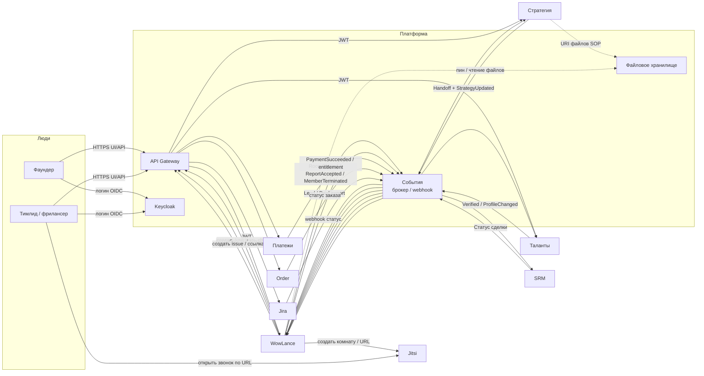

# WowLance — карта обменов с соседними сервисами

| Поле | Значение |
|------|----------|
| **Дата** | 2026-10-06 |
| **Зачем** | Наглядно: *что* уходит/приходит и *каким каналом* |
| **Допущение** | Концепция Hybrid (снимок + события). SRM = контур сделок/лидов (CRM). Конкретный брокер — выбор платформы |

---

## 1. Общая картина

```text
                         ┌─────────────────────┐
                         │     API Gateway     │
                         │  (HTTPS + JWT check)│
                         └──────────┬──────────┘
                                    │
         ┌──────────────────────────┼──────────────────────────┐
         │                          ▼                          │
         │                 ┌─────────────────┐                 │
         │                 │    WowLance     │                 │
         │                 │  комната + люди │                 │
         │                 │  (своя PostgreSQL)│                │
         │                 └────────┬────────┘                 │
         │                          │                          │
    ┌────┴────┬─────────┬───────────┼──────────┬─────────┬─────┴────┐
    ▼         ▼         ▼           ▼          ▼         ▼          ▼
 Keycloak  Стратегия  Таланты     SRM      Платежи    Order      Jira
 (вход)   (handoff)  (roster)   (лиды)   (деньги)  (заказ)   (тикеты)
                                    │
                                    ▼
                                 Jitsi
                              (видеозвонок)
```

**Три канала (технологии):**

| Канал | Технология | Когда |
|-------|------------|--------|
| **A. Запрос–ответ** | HTTPS + JSON через Gateway (OpenAPI) | Нужен ответ сразу |
| **B. Событие** | Брокер *или* webhook HTTPS + JSON | «Случилось → расскажи другим» |
| **C. Ссылка наружу** | HTTPS URL (иногда JWT/токен в ссылке) | Пользователя уводим во внешний UI (Jitsi, Jira) |

Файлы SOP/стратегии: **не** через брокер целиком → **object storage** + в сообщении только ссылка, версия, checksum.

Авторизация сервис↔сервис: **Keycloak** (user JWT или client credentials).

---

## 2. Схема потоков (Mermaid)



---

## 3. По каждому сервису: данные и канал

### 3.1. Keycloak (авторизация)

| Направление | Данные | Канал |
|-------------|--------|--------|
| → Keycloak | Логин пользователя, logout | OIDC (браузер) |
| ← Keycloak | JWT: `sub` (ID), роли, email/имя | Bearer token на каждый запрос через Gateway |
| WowLance → Keycloak | Проверка токена / client credentials к другим API | OIDC / JWKS |
| В БД WowLance | Тень пользователя: тот же `sub`, кэш роли/имени | Не обмен, локально |

**Не ходит:** стратегия, задачи, лиды.

---

### 3.2. Стратегия (Founder Studio)

| Направление | Данные | Канал |
|-------------|--------|--------|
| → WowLance | Handoff: ID стратегии, версия, оффер, ICP, BP, пакет слотов, budget hint, founder `sub`, URI SOP | **B** событие *и/или* **A** HTTPS «создай комнату» |
| → WowLance | «Стратегия опубликована vN+1» | **B** событие |
| ← Стратегия (из storage) | Файлы SOP/документов | **C**/storage по URI из handoff |
| WowLance → Стратегия | «Комната создана / стартовала», опционально KPI-хуки | **B** событие |
| WowLance → Стратегия | «Дай версию N» (если снимка не хватило) | **A** HTTPS |

**Не читаем** БД Стратегии напрямую.

---

### 3.3. Таланты

| Направление | Данные | Канал |
|-------------|--------|--------|
| → WowLance | Фрилансер verified: `sub`, навыки, уровень, каналы, video URL, статус | **B** событие (upsert roster) |
| → WowLance | Смена профиля / suspend / unavailable | **B** событие |
| WowLance → Таланты | Принят отчёт, рейтинг-сигнал, расторжение | **B** событие |
| WowLance → Таланты | Точечно «актуальный профиль» по кнопке | **A** HTTPS |
| Внутри WowLance | Matching и состав комнаты | Только **локальный roster** |

---

### 3.4. SRM (контур лидов / сделок)

| Направление | Данные | Канал |
|-------------|--------|--------|
| WowLance → SRM | Hot-лид / заявка: контакт, проект, критерии, `wowlance_id` | **B** событие или **A** create |
| → WowLance | Стадия сделки, «закрыт / отказ / сумма» | **B** webhook/событие |
| UI | Deeplink «открыть в SRM» | **C** URL |

В комнате — тонкая копия или только ID сущности SRM; полноценная воронка **не** в WowLance.

---

### 3.5. Платежи

| Направление | Данные | Канал |
|-------------|--------|--------|
| → WowLance | Оплата прошла / entitlement «можно staff’ить» | **B** событие |
| WowLance → Платежи | Инициация / уточнение начисления (если комната инициирует дозаказ) | **A** HTTPS |
| UI | «Оплатить» (если ведём на платёжную страницу) | **C** URL |

Связка с handoff: комната может создаться до оплаты, а staffing — только после `PaymentSucceeded` (продуктовое правило).

---

### 3.6. Order

| Направление | Данные | Канал |
|-------------|--------|--------|
| → WowLance | Статус заказа пакета/слотов (создан, оплачен, отменён) | **B** событие |
| WowLance → Order | Дозаказ мест / смена пакета из комнаты | **A** HTTPS |
| Связь | `order_id` ↔ `room_id` | В снимке / integrations |

Order отвечает на «что купили»; Платежи — на «деньги прошли». Их можно склеить на платформе, для WowLance важны оба сигнала или один агрегированный entitlement.

---

### 3.7. Jira

| Направление | Данные | Канал |
|-------------|--------|--------|
| WowLance → Jira | Создать/обновить issue из задачи комнаты (особенно develop) | **A** HTTPS API |
| → WowLance | Смена статуса issue | **B** webhook |
| UI | «Открыть в Jira» | **C** URL |
| В WowLance | `jira_issue_key` на задаче | Локально |

Sale-комната может жить без Jira; develop — типичный consumer.

---

### 3.8. Jitsi

| Направление | Данные | Канал |
|-------------|--------|--------|
| WowLance → Jitsi | Имя комнаты / URL встречи (team, director↔teamlead) | Генерация URL или **A** API провайдера |
| Люди → Jitsi | Видеозвонок | **C** браузер по ссылке |
| ← Jitsi | Обычно **нет** обратного потока в MVP (без записи/аналитики) | — |

Секреты/JWT для приватных комнат — по политике платформы Meet; для публичного MVP достаточно стабильной ссылки.

---

## 4. Сводная матрица «канал × сервис»

| Сервис | В WowLance | Из WowLance | Основной канал |
|--------|------------|-------------|----------------|
| Keycloak | JWT, `sub`, роли | проверка / service token | OIDC |
| Стратегия | handoff, обновления, URI файлов | room started, KPI-хуки | событие + HTTPS |
| Таланты | verified, профиль, suspend | рейтинг, termination | событие (+ HTTPS точечно) |
| SRM | стадии сделки | лиды / заявки | событие / HTTPS + URL |
| Платежи | payment / entitlement | charge / дозаказ | событие + HTTPS |
| Order | статус заказа | дозаказ пакета | событие + HTTPS |
| Jira | статус issue | create/update issue | HTTPS + webhook + URL |
| Jitsi | — | URL встречи | URL (редко API) |
| Storage | чтение/пин SOP | — | HTTPS к object storage |

---

## 5. Что остаётся только внутри WowLance

Эти данные **не** являются чьей-то чужой БД и **не** требуют брокера, чтобы комната жила:

- членство в комнате, роли в комнате;
- спринты, задачи, чеклисты, отчёты (файлы доказательств — свой storage);
- снимок стратегии выбранной версии;
- локальный roster для подбора;
- лента активности комнаты.

Соседи питают вход и забирают факты наружу; **исполнение** — у WowLance.

---

## 6. Как читать схему на демо без соседей

Все стрелки **B** и **A** к Стратегии/Талантам/SRM/Платежам/Order/Jira заменяются **эмулятором** с тем же JSON. Jitsi — реальная публичная ссылка или заглушка URL. Keycloak — demo-realm или mock OIDC. Карта обменов при подключении живых сервисов **не меняется** — меняется только «кто на том конце».

---

## 7. Короткая легенда для PO

- **Синий путь (люди):** вошли через Keycloak → Gateway → WowLance.  
- **Оранжевый путь (факты):** Стратегия/Таланты/Платежи/Order/SRM/Jira шлют «случилось» событиями.  
- **Зелёный путь (ссылки):** Jitsi, карточка SRM, тикет Jira — человек уходит по URL.  
- **Файлы:** лежат в хранилище; в сообщениях — только ссылки и версии.
