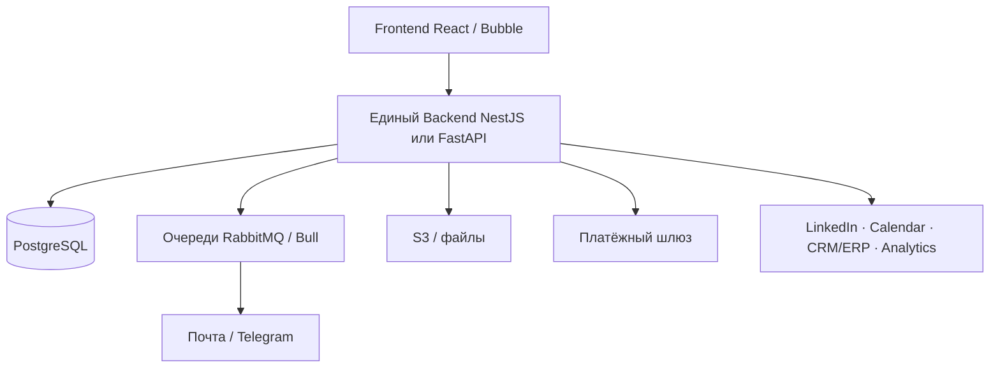

# Исходное ТЗ vs WowLance 2.0 — структура и схемы

| Поле | Значение |
|------|----------|
| **Источник** | `010101 - WOWLance (1) исходное ТЗ.docx` (папка «Стажировка Wowlance») |
| **Дата разбора** | 2026-10-08 |
| **Связано** | [05-integration-map.md](05-integration-map.md) · [01-overview.md](01-overview.md) |

---

## 1. Есть ли в исходном ТЗ схема микросервисов?

**Нет.**

- В файле **нет** встроенных рисунков/диаграмм (в docx только текст, без `media`).
- Раздел **VI. Архитектура и стек** описывает не набор микросервисов, а **слои одного решения** (frontend / backend / БД / очереди / файлы / платежи) + **внешние интеграции**.
- Упоминания «схем» в ТЗ — про **BPMN / блок-схемы процессов** (AS-IS / TO-BE) и документы вижена клиента, не про карту сервисов платформы.
- Слово «микросервис» в архитектуре **не задаёт** нарезку вроде Strategy / Talent / Room.

Итог: из ТЗ можно вывести **логическую структуру продукта и интеграций**, но не готовую microservice-map. Ниже — схема, восстановленная по тексту ТЗ.

---

## 2. Что ТЗ считает «архитектурой»

### Тип решения (цитата по смыслу)

**Гибрид: low-code + кастомные модули** (в тексте — «wecoding»).  
MVP можно на Bubble; целевой контроль сложной логики — свой backend.

### Компоненты (таблица из §VI)

| Компонент | Назначение | Технологии в ТЗ |
|-----------|------------|-----------------|
| Frontend | UI ролей, комнаты, дашборды | React (Next.js) или Bubble/Adalo |
| Backend | Бизнес-логика, API, комнаты, статусы | NestJS или **FastAPI**; MVP — Bubble + webhooks |
| База данных | Сущности, связи, логи | **PostgreSQL** (JSONB) |
| Очереди | Уведомления, отчёты, интеграции, SLA-таймеры | **RabbitMQ** / Bull / очереди low-code |
| Файловое хранилище | Скрины, документы, шаблоны | **S3** / Cloudinary / Supabase Storage |
| Платёжный шлюз | Запуск, подписка, выплаты | Stripe / YooKassa / CloudPayments |
| Уведомления | Почта, мессенджеры | SendGrid / Mailgun / Telegram / Twilio |
| Аудит | Логи действий | ELK / Graylog или таблица AuditLog |

### Внешние интеграции в ТЗ

| Интеграция | Способ |
|------------|--------|
| LinkedIn | API / вебхуки (без парсинга) |
| Почта / мессенджеры | SMTP / API |
| Календарь | Google / Outlook API |
| CRM/ERP клиента | REST / вебхуки |
| Аналитика | Superset / Metabase / встроенные графики |
| Файлы | S3 API |

### Принципы из ТЗ

- event-driven смена статусов (Hot → задача менеджеру);
- валидация в API и БД;
- RBAC;
- SLA через очереди и планировщик.

### Логические домены внутри одного продукта (по сущностям и экранам)

Всё это в ТЗ — **экраны и сущности одной платформы**, не отдельные деплои:

```text
Identity / Profiles     — регистрация, роли, профиль, журнал фрилансера
Marketplace / Matching  — пул сейлов, фильтры, подбор в проект
Projects / Rooms        — проект, комната, вкладки, чат, документы
Execution               — задачи, отчёты, чеклисты, Quality Gate
Leads / Deals           — квалификация, горячие лиды, сделки менеджера
Payments / Orders       — тарифы, оплата запуска, подписка, выплаты
Notifications / Audit   — письма, напоминания, AuditLog
```

Директор **создаёт проект и платит внутри WOWLANCE**. Фрилансер **регистрируется и попадает в пул внутри WOWLANCE**. Стратегия — шаблоны/вводные **в комнате**, не отдельный продукт «Studio».

---

## 3. Схема по исходному ТЗ (восстановленная)

Схемы микросервисов в документе нет — это **реконструкция §VI + домены продукта**.

```text
                    ┌──────────────────────┐
                    │   Frontend (React /  │
                    │   Bubble)            │
                    └──────────┬───────────┘
                               │ HTTPS / API
                    ┌──────────▼───────────┐
                    │  Backend (один)      │
                    │  NestJS / FastAPI    │
                    │  комнаты, статусы,   │
                    │  matching, deals…    │
                    └─────┬─────┬─────┬────┘
          ┌───────────────┘     │     └───────────────┐
          ▼                     ▼                     ▼
   PostgreSQL              RabbitMQ /            S3 / Storage
   (одна БД продукта)      очереди SLA           вложения, шаблоны
                                │
                    ┌───────────┼───────────┐
                    ▼           ▼           ▼
              Stripe/YooKassa  SendGrid/TG   CRM/ERP, LinkedIn,
              (платежи)        (уведомления) Calendar, Analytics
```



**Вывод по ТЗ:** это **модульный монолит (или low-code + кастом) с внешними SaaS**, а не зоопарк бизнес-микросервисов WOWLANCE.

---

## 4. Схема, которую мы разработали (WowLance 2.0)

Кратко из [05-integration-map.md](05-integration-map.md):

```text
Keycloak · Gateway · Стратегия · Таланты · WowLance(комната)
SRM · Платежи · Order · Jira · Jitsi · общий Storage
```

WowLance — **один** сервис исполнения (room: BP, SOP, спринты, задачи) + локальные тени пользователей/roster. Стратегия и верификация фрилансеров — **до** входа. Обмен: HTTPS + события + URI файлов (версия в пути — [00-decisions.md](00-decisions.md)).

---

## 5. Сравнение

| Тема | Исходное ТЗ (010101) | Наша проработка 2.0 |
|------|----------------------|---------------------|
| Единица поставки | Одна платформа WOWLANCE | WowLance = сервис комнаты в экосистеме |
| «Микросервисы» | Не описаны; есть слои + внешние SaaS | Явная нарезка: Strategy, Talent, Auth, SRM, Pay, Order, Jira, Jitsi |
| Откуда проект | Директор создаёт и оплачивает **внутри** | Handoff из **Стратегии** по кнопке |
| Откуда фрилансеры | Регистрация и пул **внутри** | Только после **Талантов**; свой roster |
| Сделки менеджера | Экраны Deals **внутри** продукта | Вынос в **SRM**, комната — handoff |
| Оплата | Модуль Payments + шлюз | Отдельные **Платежи / Order** + entitlement |
| Авторизация | Вход/регистрация в продукте | Общий **Keycloak**, тень User по ID |
| UI / API | React или Bubble; Nest/FastAPI | React + FastAPI + Gateway (согласовано с «целевым» стеком ТЗ) |
| БД | Одна PostgreSQL на продукт | Своя PostgreSQL у WowLance; чужие БД не читаем |
| Очереди | RabbitMQ внутри решения | Брокер/webhook **платформы** между сервисами |
| Файлы | S3 как компонент платформы | Общий storage, **версия в пути**, без обязательного копирования всех SOP |
| Чат / видео | Чат комнаты в продукте; Jitsi в ТЗ **не** выделен | Чат — вопрос scope; **Jitsi** — внешний по URL |
| Jira | Нет | Внешняя для develop-шаблона |
| Matching | Внутри backend + пул | Локальный roster + события Talent |
| Схема в документе | **Нет** (только текст §VI) | Есть: overview, concepts A/B/C, integration map |

### Где мы совпадаем с ТЗ

- Комната проекта как ядро исполнения.
- Роли: директор, тимлид, фрилансер, менеджер платформы.
- Задачи, отчёты со скрином, Hot → менеджер.
- Стек ориентира: FastAPI, React, PostgreSQL, очереди, S3, платёжный шлюз, CRM по API/webhooks.
- Event-driven статусы и RBAC.

### Где мы сознательно ушли от ТЗ

| ТЗ | 2.0 |
|----|-----|
| Всё в одном продукте | WowLance не владеет стратегией, онбордингом сейлов и (целевым) CRM сделок |
| Low-code Bubble как путь MVP | Платформенный контур микросервисов + greenfield комнаты |
| Регистрация и обучение «не в scope» частично, но пул свой | Верификация до нас — жёсткое правило |
| Deals / Payments как разделы WOWLANCE | Соседние сервисы |
| Нет Keycloak / Gateway | Обязательная платформенная обвязка |

Это не противоречие «ТЗ запрещает», а **эволюционный срез**: исходное ТЗ рисовало **цельный продукт продаж**; 2.0 встраивает **кусок исполнения** в большую инфраструктуру.

---

## 6. Как читать «структуру микросервисов» из ТЗ честно

Если натянуть ТЗ на микросервисы **задним числом**, логичные границы такие (в самом документе они **не названы сервисами**):

| Условный сервис «из доменов ТЗ» | Что в ТЗ |
|--------------------------------|----------|
| Identity | Регистрация, роли, профиль |
| Catalog / Talent pool | Маркетплейс сейлов, matching |
| Room / Project | Комната, задачи, лиды, чат, документы |
| Deal desk | Менеджер, deals, hot handoff |
| Billing | Payments, тарифы, выплаты |
| Notify | Очереди уведомлений |
| + внешние | Stripe, S3, CRM, LinkedIn, Calendar |

**Наша 2.0-нарезка жёстче и другая:** Identity → Keycloak; Catalog → Таланты (+ часть в WowLance roster); создание проекта/вижена → Стратегия; Deal desk → SRM; Billing → Платежи/Order; Room → WowLance; плюс Jira/Jitsi.

---

## 7. Вывод

1. В **010101 исходное ТЗ схемы микросервисов нет** — есть таблица слоёв одного решения и список внешних интеграций.  
2. Восстановленная схема ТЗ — **монолитный backend + PostgreSQL + RabbitMQ + S3 + платёжный/уведомлёнческий SaaS**.  
3. Наша схема 2.0 — **экосистема сервисов**; WowLance отвечает за комнату исполнения и стыкуется контрактами, а не за весь продукт из §I–VII ТЗ.  
4. Пересекаются смысл комнаты и целевой стек (FastAPI/React/PG/S3/очереди/CRM API); **расходятся** границы владения стратегией, талантами, сделками и оплатой.

Рекомендация для PO: при споре «так было в ТЗ» опираться на этот документ — исходник описывал **единую платформу**, текущее решение — **сервис комнаты в платформе**.
